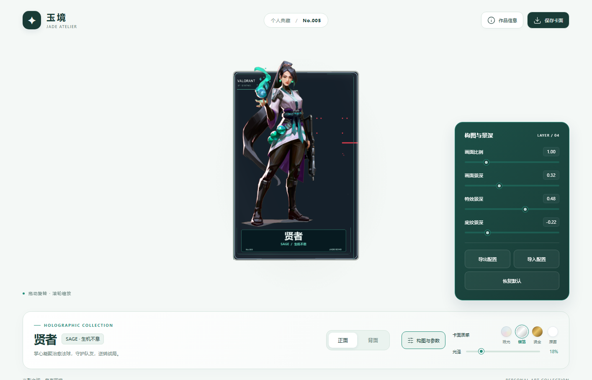

# 贤者 · Sage

基于网络角色立绘制作的玉青银白浮雕闪卡，编号 **No.005**。支持旋转、缩放、翻面、材质调整、PNG 截图与配置导入导出。



## 本地查看

需要 Node.js 22+，网页已打包，展示时无需安装 npm 依赖。

```bash
node examples/sage/web/server.mjs
```

打开 http://127.0.0.1:4173/。自定义端口时，在 PowerShell 中运行：

```powershell
$env:PORT='4177'
node examples/sage/web/server.mjs
```

## 工程文件

- `card.blend`：可编辑 Blender 工程，图片已打包。
- `web/`：独立网页与分层素材。
- `assets/`、`card-config.json`：构建输入与卡片配置。
- `prepare_card.py`：将网络素材适配到卡片画布，并生成排版和对应线稿。
- `apply_viewer_overrides.py`：构建后应用常规文字选中和复制限制；输入控件仍可正常编辑。

在仓库根目录重新构建：

```bash
python -m pip install Pillow numpy
python scripts/run_pipeline.py --project examples/sage
python examples/sage/apply_viewer_overrides.py
```

`prepare_card.py` 使用 Windows 微软雅黑及 Arial；其他系统重新排版时需调整字体路径。网页使用 GLSL 重建材质，与 Blender 渲染接近但不逐像素一致。

## 素材与验证

角色立绘来自 Riot 原画的 VALORANT-API 社区镜像，背景与背面来自 Riot 官方角色页面和壁纸；原始图片及下载地址保存在 `references/`。完整来源见 [sources.md](sources.md)。没有使用 AI 生成角色。

完整浏览器检查 70 项通过，最后的桌面检查 30 项通过；复制限制与输入控件分别验证。记录见 [validation.json](validation.json)。

本示例用于个人展示，不代表 Riot 官方发行；原图版权归 Riot Games。代码遵循仓库的 [MIT License](../../LICENSE)。示例图片、模型和工程不包含在 Skill 安装包中。
